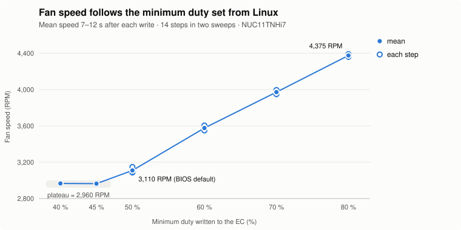
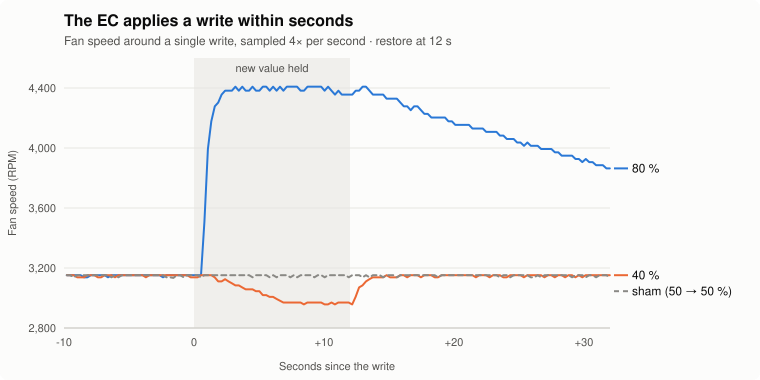

<div align="center">

# nuc11-ec-fan

**Linux fan control for the Intel NUC 11 Pro (NUC11TN, "Tiger Canyon")**

Read the fan speed and run a CPU-temperature fan curve: no BIOS trip, no Windows, no kernel module.

[](LICENSE)
[](../../releases/latest)


<picture>
  <source media="(prefers-color-scheme: dark)" srcset="docs/img/dose-response-dark.svg">
  
</picture>

</div>

## Why

On the NUC 11 Pro the fan is not driven by a Super I/O chip that Linux supports (`it87`, `nct6775`, …). The embedded controller (EC) runs it, so the BIOS fan curve is normally the only knob, and Intel's Windows tool for it was discontinued in 2024.

This project talks to the EC's shared memory directly:

- 📈 **Read** the fan speed, the EC's temperatures and the active fan profile.
- 🌡️ **Control** the fan with your own CPU-temperature curve, as a systemd service or an Unraid User Script.
- 🛡️ **Stay safe:** one byte is written, the fan curve is clamped to 40–100 %, and the original value is restored when the curve stops.

> [!NOTE]
> **Does it work?** Yes, on the tested machine (NUC11TNHi7, BIOS `TNTGL357.0064`). Writing one byte from Linux reproducibly raises and lowers the fan speed. This was confirmed in a pre-registered experiment with sham writes and temperature-matched comparisons, and backed by an independent cooling effect. See [Evidence](#evidence).

> [!WARNING]
> This writes to undocumented EC memory through `/dev/mem`. It is tested on **one** NUC model and BIOS. Use at your own risk. `ecmem` refuses to run unless the EC identifies itself as `NUC_EC`. `ecmem write` can put any value into one byte of fan record 1. The fan-curve script only writes the min-duty byte, clamped to 40–100 %.

**Contents:** [Compatibility](#compatibility) · [Quick start](#quick-start) · [How it works](#how-it-works) · [Evidence](#evidence) · [Files](#files) · [Reporting other models](#reporting-other-models)

## Compatibility

| | |
| --- | --- |
| Tested | Intel NUC11TNHi7, BIOS `TNTGL357.0064` (Unraid 7.3, kernel 6.18) |
| Probably similar | Other NUC11TN models (TNHi3/5/7, TNKi*). Unverified: please [report](#reporting-other-models) |
| Not supported | NUC 11 Extreme/Enthusiast and other generations (different EC layouts) |
| Requires | x86-64 Linux, root, `/dev/mem` access to MMIO. Kernel lockdown (often enabled with Secure Boot) blocks this: `/sys/kernel/security/lockdown` must show `[none]` or not exist |

## Quick start

### 1. Get `ecmem`

Download the static binary from the [latest release](../../releases), or build it:

```sh
gcc -O2 -Wall -Wextra -static -o ecmem ecmem.c
```

If you build it yourself, its hash differs from the release binary. Before installing the fan curve, set `ECMEM_SHA256` at the top of `fan-curve/nuc-fan-curve.sh` to the output of `sha256sum ecmem` (for both systemd and Unraid).

`ecmem read` dumps the EC window (0x100 bytes). `ecmem write <offset> <old> <new>` writes one byte under three conditions: the offset is inside fan record 1 (`0x80..0x8D`), the EC ID is `NUC_EC`, and the current value equals `<old>`.

### 2. Check your machine (read-only)

```sh
sudo ./ecmem read | head -2     # first bytes should spell NUC_EC: 4e 55 43 5f 45 43
sudo ./nuc-fan.sh ./ecmem       # RPM and the decoded fan record
```

### 3a. Fan curve with systemd

```sh
sudo install -Dm755 ecmem /usr/local/lib/nuc-ec-fan/ecmem
sudo install -m755 fan-curve/nuc-fan-curve.sh /usr/local/sbin/nuc-fan-curve
sudo install -m644 fan-curve/nuc-fan-curve.service /etc/systemd/system/
sudo systemctl daemon-reload
sudo systemctl enable --now nuc-fan-curve
```

To change the curve, edit the settings at the top of `/usr/local/sbin/nuc-fan-curve` and run `sudo systemctl restart nuc-fan-curve`. Running `systemctl stop nuc-fan-curve` restores the original value. To see what it is doing:

```sh
cat /run/nuc-fan-curve.status
journalctl -t nuc-fan-curve
```

### 3b. Fan curve on Unraid

This requires the *User Scripts* plugin.

1. Copy `ecmem` to `/boot/config/plugins/nuc-ec-fan/ecmem`.
2. Create two user scripts with the contents of `fan-curve/nuc-fan-curve.sh` and `fan-curve/nuc-fan-curve-stop.sh`.
3. Schedule "NUC fan curve" as **At First Array Start Only**, and run it once.

To change the curve, edit the script and click *Run Script*. Stop it with "NUC fan curve stop"; the *Abort* button does not stop the background loop.

### Settings

```sh
CURVE="50:45 60:50 70:65 80:85 90:100"   # "CPU °C:minimum fan %" pairs, interpolated
INTERVAL=5                               # seconds between checks
HYSTERESIS=3                             # °C cooler before the fan is lowered
ECMEM_SHA256=…                           # hash of your ecmem binary (default = release binary)
```

How it behaves:

- **It sets a minimum, not a fixed speed.** The value is the *minimum* duty of the EC's own fan curve, so the EC still speeds the fan up when it gets hot. The fan can never run slower than the BIOS curve allows above that minimum.
- **No lower than about 45 %.** Values are clamped to 40–100 %, and on the tested machine the fan did not get slower below about 45 % (≈ 2960 RPM).
- **Safety:**
  - Only one instance can run.
  - Changes made by others are corrected.
  - The original value is restored on stop or signal, if the CPU temperature becomes unreadable, or after 3 failed writes.

## How it works

The EC exposes a shared-memory window at physical address `0xFE410400` (0x100 bytes; the ACPI region `H2RA` starts at `0xFE410000`). Observed on the tested machine:

| Offset | Content |
| --- | --- |
| `+0x00` | ASCII EC ID `NUC_EC` |
| `+0x10..0x15` | Temperature pairs (source id, °C), e.g. source 4 at `+0x11` |
| `+0x1C` | Fan present flag (`01`) |
| `+0x1D..0x1E` | Fan RPM, big-endian |
| `+0x80..0xDD` | Fan profile: six 14-byte records, each followed by 2 bytes not part of the record |

The fan record layout follows the analysis of Intel *NUC Software Studio* for the NUC11PH in [CodeGrogu/intel-nuc-software-studio-decompiled](https://github.com/CodeGrogu/intel-nuc-software-studio-decompiled):

| Byte | Field |
| --- | --- |
| 0–5 | Primary: temperature source, max temp °C, min temp °C, **min duty %**, duty increment per °C, fan-off temp °C |
| 6–11 | Secondary: same six fields |
| 12 | config1 (bit 7: fixed/custom mode on ECNUC22) |
| 13 | config2 (bit 7: zero-RPM / fan-off on ECNUC22) |

<picture>
  <source media="(prefers-color-scheme: dark)" srcset="docs/img/time-course-dark.svg">
  
</picture>

Only record 1's primary min duty (offset `0x83`) is written. Intel's Windows driver writes whole profiles through a kernel IOCTL. The experiments below show that, for this field, writing the byte into the window is enough: the EC applies it immediately, with no further notification.

## Evidence

All raw data, scripts and the chart generator (`research/make_charts.py`) are in [`research/`](research/).

**First test** (`research/fan-write-test.sh`): raising min duty from 50 % to 70 % for 30 s moved the fan from about 3200 to about 4000 RPM within one 3-second sample. After the restore, it declined back to about 3200 RPM.

<details>
<summary><b>Pre-registered controlled sweep</b>: design, criteria and results</summary>

Scripts: `research/fan-sweep-test.sh` and `research/analyze-sweep.py`. Script, settings, thresholds and verdict rules were frozen in commit `fb7d3ab` before the confirmatory run.

- **Plan:** 14 steps in two sweeps, the second in reverse order: sham (the original value written over itself), 60, 40, 80, sham, 70, 45 %.
- **Each step:** ≥ 60 s baseline at 50 %, a 12 s hold, restore, verify.
- **Sampling:** 4 samples per second, with the byte checked on every sample. Any mismatch, read error or CPU ≥ 65 °C aborts and restores.
- **Temperature matching:** RPM is compared only between baseline and hold samples with the *same* pair of fan-record temperatures (CPU and EC source 4). A pure temperature effect therefore cannot pass.

| Criterion | Result (`research/results/run2-confirmatory.csv`) |
| --- | --- |
| C1 sham steps \|Δ\| < 80 RPM | PASS (−1, −52, +7, −4) |
| C2 every active step in the right direction, \|Δ\| ≥ 120 RPM | PASS (10/10) |
| C3 strictly monotonic within each sweep | **FAIL** (40 % ≈ 45 %, see the plateau below) |
| C4 ≥ 3 temperature-matched hold samples per step | PASS (11–20) |
| C5 both sweeps agree per value | PASS |
| C6 bytes as planned, restored, end RPM near baseline | PASS |
| C7 complete plan, no failures | PASS |

Temperature-matched change versus the 50 % baseline (RPM):

| min duty | 40 % | 45 % | 60 % | 70 % | 80 % |
| --- | --- | --- | --- | --- | --- |
| Sweep 1 | −183 | −145 | +457 | +817 | +1240 |
| Sweep 2 | −150 | −181 | +458 | +851 | +1214 |

The overall pre-registered verdict fails on C3. The conclusion "the fan speed can be raised and lowered from Linux" rests on C1, C2 and C4–C7, none of which were changed after seeing data.

What else was observed:

- **Physical effect** (exploratory, earlier run with 30 s holds): CPU temperature fell after all 6 raises (−0.4 to −1.2 °C) and rose after all 4 reductions (+0.2 to +1.0 °C). Sham steps were mixed. The reported RPM corresponds to real airflow.
- **Plateau** (exploratory): at 40 % and 45 % the fan sat at about 2960 RPM (2953–2970) in every such step of both runs.
- **The earlier run failed its own temperature-overlap criterion.** It is kept for transparency in `research/results/run1-exploratory.csv`.

</details>

Limits:

- one machine and BIOS;
- RPM as reported by the EC (no external tachometer);
- integer temperature resolution;
- only this one field tested;
- reboot behaviour untested (the EC is expected to reload the BIOS profile at power-on).

## Files

| Path | Purpose |
| --- | --- |
| `ecmem.c` | EC window reader and guarded single-byte writer |
| `nuc-fan.sh` | Read-only status: RPM and the decoded fan record 1 |
| `fan-curve/nuc-fan-curve.sh` | CPU-temperature fan curve (systemd `--foreground`, or Unraid background mode) |
| `fan-curve/nuc-fan-curve.service` | systemd unit |
| `fan-curve/nuc-fan-curve-stop.sh` | Unraid stop helper |
| `research/` | One-shot test, controlled sweep, analyzer and raw results |

## Reporting other models

If you have another NUC 11 Pro, read-only output helps a lot. Open an issue with:

- `sudo dmidecode -s baseboard-product-name` and `sudo dmidecode -s bios-version`
- the first two lines of `sudo ./ecmem read`, and the output of `sudo ./nuc-fan.sh ./ecmem`

Please do not try writes on untested models without reading the code first.

## Credits

- The fan record layout and driver background come from [CodeGrogu/intel-nuc-software-studio-decompiled](https://github.com/CodeGrogu/intel-nuc-software-studio-decompiled).
- The idea of reading fan RPM from the EC window comes from [mikns/nuc-fan-rpm](https://github.com/mikns/nuc-fan-rpm) (NUC10).

This project is not affiliated with Intel or ASUS.

## License

[MIT](LICENSE)
